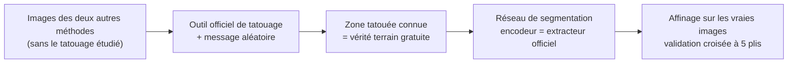
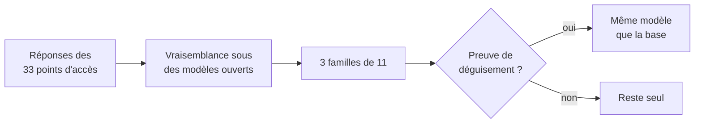
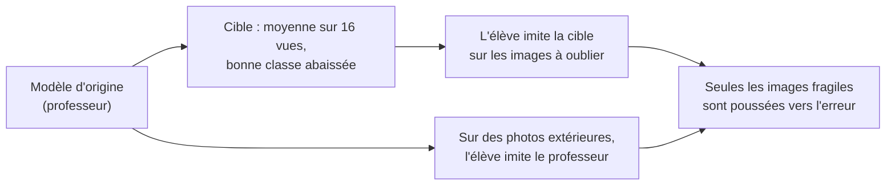

<h1 align="center">European AI Championship 2026 · équipe Epi84</h1>

<p align="center">
Trois défis de sécurité de l'IA, 22 heures, un nœud de 4 GPU.<br/>
Paris, 21–22 novembre 2026.
</p>

| | Défi | Ce qu'il fallait faire | Score public à la clôture |
|:-:|---|---|:-:|
| 1 | [Localiser un tatouage invisible](watermark/) | Trouver, dans chaque image, la zone qui porte un tatouage | **0,762** |
| 2 | [Reconnaître le modèle derrière une API](met/) | Dire quels points d'accès servent exactement le même modèle | **0,85** |
| 3 | [Faire oublier des images à un modèle](unlearning/) | Rendre un modèle indiscernable d'un modèle réentraîné sans 3 500 images | **0,324** |

> Ces scores viennent du classement public, calculé sur une partie des tests.
> Le classement final utilise une partie cachée.

---

## 1 · Localiser un tatouage invisible

**Le problème.** Une image porte un tatouage invisible (PixelSeal, TrustMark ou StegaStamp) sur une partie
seulement de sa surface. Il faut rendre une carte de 128 × 128 cases qui dit où il se trouve. Le score est un
mIoU. On dispose de 170 images d'exemple par méthode.

**L'idée.** Fabriquer nous-mêmes les exemples. Les organisateurs fournissent l'outil qui pose le tatouage :
si c'est nous qui tatouons une zone, nous connaissons la réponse exacte, autant de fois que nécessaire.



| Étape | Score public |
|---|:-:|
| Réseau en U sur des cartes de corrélation | 0,480 |
| Recherche de rectangles par décodage du message | 0,504 |
| Segmentation apprise sur données synthétiques | 0,654 |
| Entraînement synthétique plus long | 0,725 |
| Plusieurs réseaux moyennés et prédiction en miroir | **0,762** |

Tous les réglages sont choisis en validation croisée sur les images d'entraînement (0,751 en local),
jamais sur le classement. À chaque soumission, le score public est resté à environ 0,02 du score local.

**Où lire.**
[`espace_de_travail/v61/seg_synth_new.py`](espace_de_travail/v61/seg_synth_new.py) : générateur d'exemples et réseau ·
[`espace_de_travail/v62/decide62.py`](espace_de_travail/v62/decide62.py) : assemblage final ·
[`docs/RECHERCHE_WATERMARK.md`](docs/RECHERCHE_WATERMARK.md) : les hypothèses testées, y compris celles qui ont été rejetées.

---

## 2 · Reconnaître le modèle derrière une API

**Le problème.** Trente-trois points d'accès anonymes, cent réponses autorisées pour chacun. Il faut dire
lesquels servent le même modèle. Le piège : un déguisement (consigne cachée, persona, tatouage du texte,
température) garde le même modèle mais change beaucoup le texte, alors qu'une quantification ou un
réentraînement léger change le modèle mais presque pas le texte. Comparer les réponses ne suffit donc pas.

**L'idée.** Ne pas demander « qui se ressemble ? » mais « qui porte une preuve de déguisement ? ». Et comme
les modèles candidats sont ouverts, mesurer exactement à quel point chacun aurait pu écrire une réponse.



| Étape | Score public |
|---|:-:|
| Familles par vraisemblance, variantes par test statistique | 0,40 |
| Preuves de déguisement : réponses identiques, mots rares, fausse identité | 0,70 |
| Consigne cachée récitée par un point d'accès, base d'une famille identifiée | **0,85** |

**La limite.** La base n'est identifiée que pour une famille sur trois. Deux candidats sont restés
indiscernables du modèle de base avec cent réponses chacun : un réentraînement très léger est invisible
à ce budget.

**Où lire.**
[`met/decision.py`](met/decision.py) et
[`met/temperature.py`](met/temperature.py) : familles et test de vraisemblance ·
[`espace_de_travail/v80/NOTES.md`](espace_de_travail/v80/NOTES.md) : la dernière matinée, test par test.

---

## 3 · Faire oublier des images à un modèle

**Le problème.** Un classifieur d'images (ViT-B/16, 100 classes) doit oublier 3 500 images d'entraînement.
Le juge est un modèle réentraîné sans elles : il faut lui ressembler image par image, sans le posséder,
sans les autres images d'entraînement et sans les étiquettes. Le score vaut zéro si le modèle perd trop
en précision.

**L'idée.** Oublier, ce n'est pas tout rater. Un élève qui a appris des corrigés par cœur doit, pour faire
comme s'il ne les avait jamais vus, hésiter là où un autre élève hésiterait.



| Étape | Score public |
|---|:-:|
| Première cible adoucie | 0,014 |
| Oublier davantage | 0,045 |
| Éteindre les classes presque entièrement retirées | 0,135 |
| Cible moyennée sur 16 vues de chaque image | 0,151 |
| N'éteindre que deux classes | 0,246 |
| Viser des images fragiles plutôt que des classes | 0,286 |
| Deux indicateurs de fragilité combinés | 0,294 |
| Tout rendre un peu plus hésitant | 0,314 |
| Réglage de la marge de l'étape 2 | **0,324** |

**La limite.** Environ 75 soumissions ont servi à régler la méthode sur le classement public : le risque de
trop coller à ce classement est réel.

**Où lire.**
[`espace_de_travail/JOURNAL.md`](espace_de_travail/JOURNAL.md) : la démarche, version après version ·
[`espace_de_travail/v47/`](espace_de_travail/v47/) : la recette en deux étapes ·
[`espace_de_travail/v70/NOTES.md`](espace_de_travail/v70/NOTES.md) : les derniers réglages.

---

## Ce qu'on retient

- Quand on a l'outil officiel entre les mains, on peut fabriquer ses propres données d'entraînement.
- Quand les modèles sont ouverts, on peut tester exactement, et connaître la limite du test.
- Avant d'optimiser, comprendre ce que la métrique récompense.

## Organisation du dépôt

```
watermark/            tâche 1 : scripts de recherche (journal dans docs/RECHERCHE_WATERMARK.md)
met/                  tâche 2 : collecte, vraisemblance locale, décision
unlearning/           tâche 3 : baseline du kit
espace_de_travail/    copie de l'espace de travail du cluster, une version par idée :
                      v1 à v57 et v70 (tâche 3), v60 à v63 (tâche 1), v80 (tâche 2)
docs/                 énoncés des trois tâches, cluster, stratégie, état
slurm/, setup/, common/   files d'attente des GPU, partage du dossier, journal des scores
```

Les poids, les données, les réponses des API et les journaux d'exécution sont restés sur le cluster.

---

## Kit d'équipe : mode d'emploi

Agents : lisez d'abord `CLAUDE.md`. Humains : fiches 9 (tuto), 11 (rejoindre l'équipe), 12 (scripts), 6 à 8 (tâches).

```
CLAUDE.md                 guide des agents (règles, contexte, cycle de travail)
docs/TACHE_1_watermark.md       tâche 1 : localiser le tatouage (mIoU)
docs/TACHE_2_model_equality.md  tâche 2 : 33 endpoints d'API, familles et modèles (MCC)
docs/TACHE_3_unlearning.md      tâche 3 : désapprendre 3 500 images d'un ViT
docs/CLUSTER.md, STRATEGIE.md, ETAT.md   machines et files ; stratégie ; état courant (à tenir à jour)

watermark/baseline.py     tâche 1 : --mode window (décodage par fenêtres) et --mode unet (segmentation)
met/analyse.py            tâche 2 : similarité entre endpoints, familles/modèles, CSV de soumission
met/mmd_test.py           test MMD du papier (si plusieurs réponses par prompt)
unlearning/unlearn.py     tâche 3 : distillation vers des prédictions adoucies + ancre L2

slurm/env.sh              variables communes : DIR (files, clones, scores), OFFICIEL (données, venvs)
slurm/soumettre.sh        déposer une commande dans la file d'un GPU (--venv unlearning|met|watermark)
slurm/file.sh             état des 4 files ; slurm/annuler.sh : arrêter la commande en cours
slurm/noeud.sh            job du titulaire : garde le nœud, une file par GPU (worker.sh)
slurm/relancer.sh         titulaire : programme la relève du job
slurm/test.sh, shell.sh   test de fumée ; terminal de secours (titulaire)
setup/ajouter_membre.sh   ouvrir le dossier d'équipe à un membre
setup/verif_partage.sh    chaque membre : vérifier ses accès (PARTAGE OK)
setup/partage.sh, fermer.sh  créer/fermer un dossier d'équipe (déjà fait)
setup/nettoyer_depot.sh   une fois par clone : retire les anciens fichiers passés dans archive/
common/scores.py          journal des scores partagé : python -m common.scores
common/dashboard.py       tableau de bord HTML des scores

docs/references/          énoncés officiels des tâches 1 et 2, article MET (2410.20247)
watermark/README.md, met/README.md   index des scripts de chaque tâche (retenu / outil / rejeté)

archive/                  code de préparation écrit d'après les papiers (avant de connaître les vraies
                          tâches) : ne plus l'utiliser, voir archive/README.md
```

Données et environnements : dossier officiel `$OFFICIEL` (`/p/scratch/training2666/huang25/Epi84`),
créé par `hackathon_setup.sh` des organisateurs. Les trois baselines ont été testées sur données
factices (`--fake`) ; elles n'ont pas encore tourné sur les vraies données.
